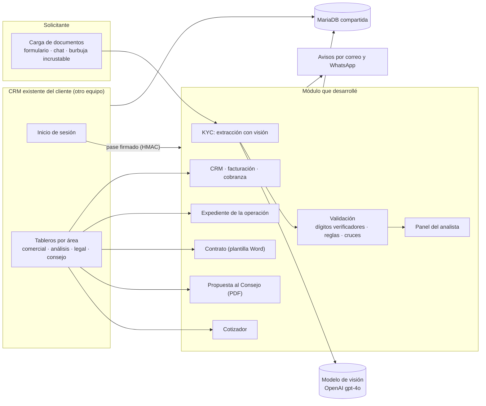

# Caso de estudio: verificación documental con IA y automatización del CRM de una arrendadora

> **Caso de estudio sin el código del cliente.** El sistema es propiedad del cliente, una
> arrendadora de autos y equipo, y lo desarrollé trabajando en **TEDE Consultores**. Aquí se explican el problema, la arquitectura y las decisiones. Los
> fragmentos de [`fragmentos/`](fragmentos/) son reescrituras genéricas de las técnicas
> que usé, sin nada específico del cliente, y se pueden ejecutar.

## Resumen

La arrendadora llevaba la originación de cada operación con documentos por correo, cotizaciones
en Excel y contratos armados a mano en Word. Construí un módulo que se integra a su CRM
existente y cubre el flujo desde que llega el prospecto hasta la cobranza mensual. El primer
paso fue un **sistema de verificación documental (KYC)**: una IA de visión lee la
identificación, el comprobante de domicilio, el recibo de nómina y el estado de cuenta; el
sistema valida lo que leyó y una persona decide.

**Principio del sistema:** ninguna regla automática aprueba ni rechaza nada. La IA y las
reglas preparan el expediente y señalan lo que conviene revisar; toda decisión la toma una
persona y queda registrada con su nombre.

## El problema

- **Captura manual de documentos.** Cada solicitud traía identificación, comprobantes, recibos
  y estados de cuenta que había que leer y capturar a mano, y revisar uno contra otro.
- **Un CRM existente que no se podía reemplazar.** La empresa ya operaba con tableros por
  área (comercial, análisis, legal, consejo), hechos por otro equipo y en producción. Lo
  nuevo tenía que entrar en ese flujo sin romperlo.
- **Documentos clave armados a mano:** la cotización salía de un Excel, el documento que el
  Consejo Directivo revisa antes de votar se escribía como correo y el contrato se llenaba
  en Word.
- **Restricciones de infraestructura:** hosting compartido (Apache/LiteSpeed), sin SSH, sin
  Composer y sin paso de build; despliegue por FTP.

## Qué construí

| Módulo | Qué hace |
|---|---|
| **Verificación documental (KYC)** | El solicitante sube cinco documentos (formulario, chat guiado o burbuja incrustable en cualquier página). Un modelo de visión extrae 30 datos en una sola llamada; el solicitante confirma y un analista dictamina. |
| **Panel del analista** | Documentos originales junto a una comparación de lo que leyó la IA contra lo que confirmó el cliente, hallazgos por regla y dictamen con comentario. |
| **Cotizador** | Motor de cotización de cuatro productos de arrendamiento y crédito, integrado al panel de cotizaciones del CRM. Genera el PDF y un Excel con fórmulas. |
| **Propuesta al Consejo** | El documento que el Consejo lee antes de votar, generado en PDF con las cifras de la cotización aceptada. |
| **Contrato** | El contrato se genera rellenando la plantilla Word oficial del cliente, con revisión antes de emitirlo. |
| **Expediente de la operación** | Facturas (lectura de CFDI en XML), pólizas y documentos legales entre el voto del Consejo y el contrato, sin pedir dos veces lo que ya estaba en el KYC. |
| **CRM** | Embudo de prospectos, fichas de cliente, buscador y puntaje explicado. |
| **Facturación y cobranza** | Facturación de rentas (preparada para timbrar) y la vista de cobranza del mes con reportes de atraso, montada sobre el módulo de cobranza que ya tenía el cliente. |

## Arquitectura



Los dos sistemas viven en el mismo dominio y comparten la base de datos. El módulo corre en
un subdirectorio y se entra a él desde los botones de los tableros existentes, con una
sesión firmada que emite el login del CRM.

### El flujo de la verificación documental

```
documentos ─► capa 1: calidad de la foto (navegador)
           ─► capa 2: ¿es el documento correcto y se lee? (modelo, al subirlo)
           ─► extracción de los 30 datos (una llamada, esquema estricto)
           ─► depuración: dígitos verificadores, techos de importe, fechas posibles
           ─► reglas de autenticidad + verificaciones cruzadas → hallazgos con severidad
           ─► el solicitante confirma (los datos de terceros no los puede editar)
           ─► el analista revisa y decide
```

## Decisiones técnicas y por qué

**IA**

- **Una sola llamada con todos los documentos y un esquema estricto.** El modelo puede
  cruzar datos entre documentos y citar de cuál salió cada uno. Con `json_schema` en modo
  estricto la respuesta cumple el esquema o falla: no hay prosa que interpretar.
- **El esquema, el prompt y el formulario salen de un solo catálogo de campos.** Agregar un
  campo es una línea; no hay tres listas que se desincronicen.
- **Proveedor de visión intercambiable.** Todo pasa por un único punto de entrada que elige
  el proveedor por configuración y devuelve siempre la misma estructura. El prompt, el
  esquema y la validación son compartidos, para que los expedientes sean comparables sin
  importar qué modelo los leyó.
- **PDF directo a la API.** Comprobé contra la API real que el modelo acepta PDF como parte
  del mensaje. Eso evitó escribir un extractor de texto o un rasterizador, y la mayoría de
  los documentos del expediente son PDF.
- **La fecha de hoy va en el prompt.** Sin ella, el modelo juzgaba vencimientos con su
  propia fecha de corte y marcaba como «futuros» periodos que no lo eran.

**Validación y control humano**

- **La aritmética detecta lo que la IA inventa.** Un modelo que no alcanza a leer un CURP
  borroso puede devolver uno con el formato correcto que no es de nadie; el esquema no lo
  detecta y la confianza tampoco, porque la asigna el propio modelo. CURP, RFC y CLABE
  llevan dígito verificador y el sistema lo recalcula. **Un dato que no pasa su comprobación
  no se muestra para que alguien lo «confirme»:** se descarta y el analista ve el motivo.
- **Los datos de terceros no los edita el solicitante.** Saldos, abonos del banco o el
  importe del recibo se muestran, pero no se pueden cambiar; si se pudiera, cualquiera haría
  cuadrar el ingreso con los depósitos y las verificaciones cruzadas dejarían de servir.
- **Tres capas antes de que un documento malo llegue al analista**, de la más barata a la
  más cara. La primera corre en el navegador y **nunca bloquea**, porque un falso rechazo
  cuesta más que un falso aprobado.
- **Las reglas emiten hallazgos con severidad, no veredictos.** Alta o media manda a
  revisión manual; también se deja constancia de lo que se comprobó y salió bien.

**Integración con un sistema que no era mío**

- **Publicar dentro de su flujo en vez de duplicarlo.** El CRM ya enviaba por correo y
  WhatsApp los PDF registrados en su base. La cotización generada se publica ahí mismo, y
  para su sistema es una cotización más.
- **Una sola sesión.** El login del CRM emite un pase firmado con HMAC que el módulo
  verifica. El contexto va dentro de lo firmado, así que un pase emitido para una pantalla
  no sirve para otra.
- **Respaldo fechado antes de tocar cualquier archivo suyo,** y comparación contra lo
  publicado antes de subir, porque otras personas también editaban en el servidor.

**Documentos y cálculos**

- **Rellenar los formatos oficiales del cliente en vez de redibujarlos:** la solicitud
  oficial es un PDF rellenable y el contrato es su plantilla Word, convertida en plantilla
  con marcadores.
- **La cotización se congela; la solicitud no.** Una cotización emitida es una oferta con
  fecha y no cambia; las revisiones se guardan como versiones nuevas.
- **El cotizador se comprueba contra los Excel del cliente al centavo**, con una prueba
  automatizada por producto. El orden de cálculo del Excel no es opcional y la prueba lo
  vigila.
- **Excel con fórmulas generado sin librerías,** porque no hay Composer en el hosting.

## Retos que resolví

| Reto | Cómo se resolvió |
|---|---|
| El modelo devolvía identificadores verosímiles pero inventados cuando no leía bien | Validación por dígito verificador antes de mostrar nada ([fragmento](fragmentos/digitos-verificadores.php)) |
| Detectar reflejos en la foto confundía una credencial blanca con un reflejo | La capa del navegador solo mide nitidez y exposición; el reflejo lo juzga el modelo, que sabe dónde está la mancha respecto al texto ([fragmento](fragmentos/calidad-de-foto.js)) |
| Un aviso falso de «la IA no estuvo disponible» al cambiar de proveedor | El sistema pregunta si la lectura fue simulada, nunca por un proveedor concreto |
| La aplicación en un subdirectorio: una URL absoluta funcionaba en local y rompía en producción sin error visible | Todas las rutas pasan por una función `url()` en PHP y su equivalente en JavaScript; la prueba de humo corre en los dos modos |
| `json_encode` dentro de atributos HTML rompía Alpine.js en silencio | Escapado obligatorio y regla del proyecto: abrir el navegador antes de dar algo por terminado |
| Las columnas sin dato del CRM llegan como cadena vacía, no como `NULL`; un `??` se quedaba con `''` y el prellenado salía en blanco | Un helper `primerNoVacio()` para elegir el primer valor con contenido; `??` solo donde de verdad se distingue «ausente» de «vacío» |
| El hosting guardaba en caché los `.js` durante días | Versionado `?v=` en cada cambio |
| PHP portable sin certificados raíz: las llamadas HTTPS fallaban aunque `curl` del sistema funcionara | Configuración explícita del bundle de CA y un diagnóstico de entorno que lo comprueba |
| Trabajar sobre el código de otro equipo en producción y desde dos computadoras | Respaldos fechados, comparación contra lo publicado antes de subir y cambios mínimos en sus archivos |

## Resultados

- **Despliegues**, por etapas:

  | Fecha (2026) | Despliegue |
  |---|---|
  | Julio | MVP de verificación documental, desplegado como demostración |
  | 13 de septiembre | Cotizador y propuesta al Consejo |
  | 2 de octubre | Contrato |
  | 5 de octubre | Expediente de la operación |
  | 21 de octubre | CRM, sesión única y facturación |
  | Finales de octubre | Cobranza del mes |

- **Documentos que dejaron de armarse a mano:** la cotización (PDF y Excel), el documento
  para el Consejo y el contrato se generan desde los datos del sistema.
- **Pruebas automatizadas:** 27 pruebas en PHP, 16 pruebas de pantalla en el navegador y
  una prueba de humo. El cotizador se verifica al centavo contra los Excel del
  cliente.
- **Alcance:** 82 endpoints, 20 pantallas de administración y 32 tablas.


## Stack

| Capa | Tecnología |
|---|---|
| Backend | PHP 8 sin framework ni Composer; funciones con tipado estricto |
| Base de datos | MariaDB por PDO, solo sentencias preparadas (SQLite en desarrollo) |
| Frontend | HTML, Tailwind CSS y Alpine.js por CDN; widget incrustable en Shadow DOM sin dependencias |
| IA | OpenAI `gpt-4o` con visión y salida estructurada (`json_schema` estricto), llamado por cURL |
| Documentos | Generación de PDF propia, relleno de PDF y Word oficiales, Excel con fórmulas sin librerías, lectura de CFDI (XML) |
| Integraciones | Correo, WhatsApp (microservicio en un VPS) y un proveedor de timbrado de facturas |
| Infraestructura | Hosting compartido Apache/LiteSpeed, despliegue por FTP |

## Fragmentos de código

Reescrituras genéricas. Ninguna contiene datos, reglas de negocio ni identificadores del
cliente. Todas se ejecutan solas.

| Archivo | Técnica | Ejecutar |
|---|---|---|
| [`extraccion-con-vision.php`](fragmentos/extraccion-con-vision.php) | Extracción con un modelo de visión: catálogo único de campos, esquema estricto, PDF directo, fecha de hoy en el prompt y proveedor intercambiable | `php extraccion-con-vision.php` muestra el esquema; con `OPENAI_API_KEY` y archivos de prueba hace la llamada real |
| [`digitos-verificadores.php`](fragmentos/digitos-verificadores.php) | CURP, RFC y CLABE: el filtro contra identificadores inventados | `php digitos-verificadores.php` (7 comprobaciones con ejemplos oficiales) |
| [`verificaciones-cruzadas.php`](fragmentos/verificaciones-cruzadas.php) | Cotejo entre documentos con hallazgos por severidad; nunca rechaza | `php verificaciones-cruzadas.php` |
| [`sesion-firmada.php`](fragmentos/sesion-firmada.php) | Sesión única entre dos sistemas con un pase HMAC ligado a su contexto | `php sesion-firmada.php` (5 comprobaciones) |
| [`calidad-de-foto.js`](fragmentos/calidad-de-foto.js) | Nitidez por varianza del laplaciano y exposición, en el navegador | `node calidad-de-foto.js` |

## Mi rol

Desarrollé el módulo yo solo, trabajando en TEDE Consultores. El CRM existente del cliente
(tableros por área e inicio de sesión) y su módulo de cobranza base los hizo otro equipo; mi
trabajo se integró a ellos.

- La verificación documental completa: carga por formulario, chat y burbuja incrustable,
  extracción con visión, validación por dígitos verificadores, reglas de autenticidad,
  verificaciones cruzadas y panel del analista.
- El cotizador de los cuatro productos, comprobado al centavo contra los Excel del cliente.
- La propuesta al Consejo en PDF, el contrato sobre su plantilla Word y el expediente de la
  operación.
- El CRM de prospectos y clientes, la sesión única entre los dos sistemas, la facturación de
  rentas y la vista de cobranza del mes.
- Las pruebas automatizadas y los despliegues en el hosting compartido del cliente.

---

## English summary

**Case study: AI document verification and CRM automation for a leasing company.** Built at
TEDE Consultores for a vehicle and equipment leasing company in Mexico. The client's code is
not published; this repository documents the problem, architecture and decisions, with
generic, runnable code samples.

- **What it does:** applicants upload ID, proof of address, payslip and bank statement; a
  vision model (OpenAI `gpt-4o`, strict JSON schema, PDFs sent directly) extracts 30 fields
  in a single call; check digits (CURP, RFC, CLABE) and cross-document checks flag issues;
  a person always makes the decision. The same module added quoting, board proposals,
  contract generation, operation files, CRM, invoicing and collections to the client's
  existing CRM.
- **Key decisions:** the model never approves or rejects; invented identifiers are caught by
  arithmetic, not by confidence scores; the integration publishes into the existing system's
  flow instead of duplicating it, with a single HMAC-signed session.
- **Stack:** PHP 8 (no framework, no Composer), MariaDB, Tailwind and Alpine.js, OpenAI
  vision API, shared Apache/LiteSpeed hosting.
